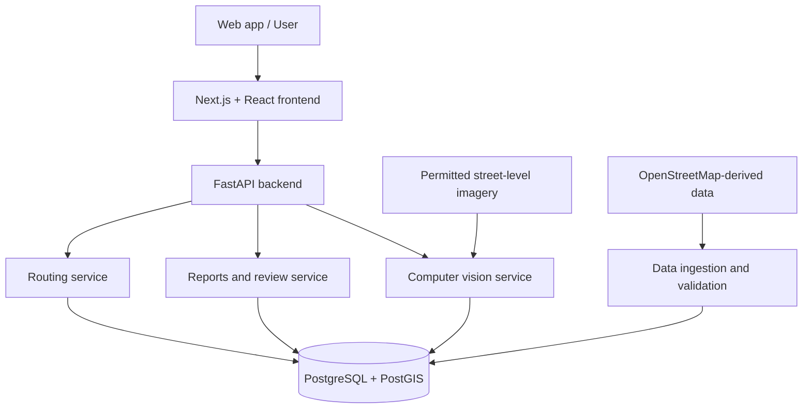

<div align="center">

# ♿ AccessPath AI

### Smarter navigation. More accessible cities.

**An AI-powered accessibility mapping and route-planning platform designed for people with mobility challenges.**

[Overview](#-overview) · [Features](#-planned-features) · [Architecture](#-system-architecture) · [Roadmap](#-development-roadmap) · [Contributing](#-contributing)


</div>

---

## 🌍 Overview

Most navigation apps optimize for **the shortest or fastest route**. But for someone using a wheelchair, a walker, or another mobility aid, the shortest route may include stairs, inaccessible crossings, steep slopes, or damaged sidewalks.

**AccessPath AI** aims to make route planning more inclusive. The platform is designed to combine geospatial data, computer vision, community reports, and accessibility-aware routing to suggest routes that better match a person's mobility needs.

Instead of asking only *“How quickly can I get there?”*, AccessPath AI also asks:

> **“Can I actually use this route safely and comfortably?”**

### 🎯 The problem we're solving

- Standard navigation often lacks reliable sidewalk and barrier information.
- Accessibility data is fragmented, incomplete, or outdated.
- Route suitability depends on individual mobility needs—not just distance.
- People need a way to report obstacles and help improve local accessibility information.

### 💡 Our approach

1. **Map** sidewalks, crossings, ramps, and other pedestrian infrastructure using available geographic data.
2. **Detect** potential barriers from street-level images using computer vision, with human review when needed.
3. **Score** route segments based on accessibility factors and user preferences.
4. **Recommend** alternatives that prioritize accessible travel, not distance alone.
5. **Improve** the map over time through community reports and data verification.

> **Project status:** AccessPath AI is currently a proposed project architecture and development roadmap. The capabilities below describe the intended product; they are **not** claims that a working implementation already exists.

---

## ✨ Planned Features

| Feature | What it will do | Phase |
| --- | --- | --- |
| 🗺️ Interactive accessibility map | Display sidewalks, crossings, obstacles, and accessible points of interest | MVP |
| 🧭 Accessibility-aware routing | Compare routes using accessibility scores and distance | MVP |
| 👤 Mobility preferences | Allow users to select routing preferences such as avoiding stairs or steep slopes | MVP |
| 📍 Community obstacle reports | Submit and review reports of blocked sidewalks, damaged paths, or missing ramps | MVP |
| 📊 Accessibility dashboard | Highlight recurring barriers and underserved areas | Phase 2 |
| 📷 Image-based barrier detection | Flag potential stairs, curb barriers, and sidewalk obstructions from images | Phase 2 |
| 🔄 Data verification workflow | Track report confidence, review status, and freshness | Phase 2 |
| 🔔 Route condition notifications | Surface relevant updates affecting previously selected routes | Future |

### User journey (target experience)

1. Open the map and choose a destination.
2. Set mobility preferences (for example, avoid stairs).
3. View suggested routes with clear accessibility information.
4. Compare trade-offs such as distance, slope, and reported obstacles.
5. Choose a route or report a newly discovered barrier.

---

## 🧠 How the Intelligence Layer Will Work

### 1. Computer vision

The proposed image-processing pipeline will analyze permitted street-level images to identify **potential** accessibility obstacles. Initial candidate classes include:

- Stairs or steps
- Missing or blocked curb ramps
- Sidewalk obstructions
- Surface damage or uneven paths

Model predictions will be treated as **unverified signals**, not as definitive safety assessments. Low-confidence results will require review.

### 2. Accessibility scoring

Each pedestrian network edge may receive a score from **0 to 100** based on available data and preferences.

An *illustrative* scoring approach:

```text
accessibility_score =
    0.30 × sidewalk_quality +
    0.25 × crossing_accessibility +
    0.20 × slope_suitability +
    0.15 × obstacle_clearance +
    0.10 × data_confidence
```

Weights are placeholders for research and testing; they are **not validated** and should vary by user need. A missing value should be marked as unknown rather than treated as accessible.

### 3. Smart route selection

A pedestrian routing graph will assign costs to connected path segments. A potential routing objective is:

```text
route_cost =
    travel_distance × distance_weight +
    accessibility_penalty +
    uncertainty_penalty
```

Hard exclusions (for example, known stairs for a step-free route) should be applied **before** optimization. Candidate algorithms include Dijkstra's algorithm and A*; the final choice will depend on the network and performance requirements.

---

## 🏗️ System Architecture



This is the **proposed architecture**, not a diagram of deployed infrastructure.

### Proposed Tech Stack

| Layer | Technology | Purpose |
| --- | --- | --- |
| Frontend | Next.js, React, TypeScript | Web interface and user flows |
| UI styling | Tailwind CSS | Responsive, accessible components |
| Maps | Leaflet + OpenStreetMap data | Map visualization |
| Backend | Python + FastAPI | API and business logic |
| Database | PostgreSQL + PostGIS | Spatial storage and queries |
| Routing | pgRouting, Dijkstra / A* | Pedestrian network analysis |
| AI / Computer Vision | PyTorch + YOLO-family models | Experimental obstacle detection |
| Deployment | To be selected | Hosting and operations |

Technology choices may change after prototyping.

---

## 📁 Proposed Repository Structure

```text
accesspath-ai/
├── frontend/                 # Next.js web application
│   ├── app/
│   ├── components/
│   └── lib/
├── backend/                  # FastAPI service
│   ├── api/
│   ├── routing/
│   ├── reports/
│   └── models/
├── ai/                       # Image analysis experiments
├── data/                     # Data schemas and sample datasets
├── docs/                     # Design decisions and documentation
├── tests/                    # Automated tests (planned)
├── .env.example              # Environment variable template (planned)
└── README.md
```

*The directory tree is a suggested structure for implementation. Files and folders may not exist yet.*

---

## 🚀 Getting Started

The implementation and runnable setup are **not available yet**. Once the first prototype is committed, this section will include:

1. Prerequisites and supported software versions.
2. Repository cloning and environment configuration.
3. Database initialization and sample data setup.
4. Commands to start the frontend and backend locally.
5. Instructions for testing the route-scoring prototype.

**Current starting point:** Create the repository and use the [development roadmap](#-development-roadmap) below to build the MVP. Avoid committing API keys, private location history, or sensitive imagery.

---

## 🗺️ Development Roadmap

### Phase 1 — MVP

- [ ] Set up frontend and backend applications.
- [ ] Import a small pilot area's pedestrian network.
- [ ] Render the interactive map.
- [ ] Build route comparison using simple, documented accessibility rules.
- [ ] Add mobility preferences and step-free exclusions.
- [ ] Add community reports with a basic moderation state.
- [ ] Test with realistic cases, including missing or uncertain data.

### Phase 2 — Intelligence & Validation

- [ ] Collect or identify appropriately licensed training/evaluation imagery.
- [ ] Prototype obstacle detection and measure false positives/negatives.
- [ ] Create a reviewer workflow for AI-generated reports.
- [ ] Combine verified reports with network-edge accessibility data.
- [ ] Measure route quality with user feedback and real-world checks.
- [ ] Add a dashboard for accessibility coverage and reporting trends.

### Phase 3 — Scale & Reliability

- [ ] Optimize spatial queries and route search performance.
- [ ] Add monitoring, automated tests, and data freshness indicators.
- [ ] Expand to additional pilot neighborhoods.
- [ ] Explore partnerships with local accessibility organizations.

---

## ♿ Accessibility, Privacy & Safety

Accessibility is not only the product's purpose; it should shape how the product is built.

- Aim for WCAG 2.2 AA in the user interface, with keyboard support, clear labels, and screen-reader-friendly navigation.
- Explain why a route is suggested, including known obstacles and areas with missing data.
- Clearly distinguish **verified**, **community-reported**, and **AI-predicted** conditions.
- Minimize collection and retention of precise user locations; request consent where required.
- Obtain rights and permissions before processing or publishing street-level imagery.
- Never present an AI prediction as a guarantee that a path is safe or accessible.

**Important:** Route suggestions will be informational and may be wrong or outdated. Until they have been rigorously validated, they should not be relied on as a sole navigation or safety resource.

---

## 📈 How Success Will Be Measured

The first pilot will focus on measurable outcomes:

- **Route suitability:** Percentage of recommended routes that pass accessibility checks in evaluation scenarios.
- **Data coverage:** Percentage of mapped pedestrian edges with usable accessibility information.
- **Report quality:** Share of community and AI flags verified as accurate.
- **Response time:** Time required to generate routes under representative workloads.
- **User feedback:** Ratings of route usefulness and clarity from pilot participants.

No performance results are claimed at this stage.

---

## 🤝 Contributing

Contributions will be welcome as the project develops, particularly in:

- Geospatial engineering and routing algorithms
- Accessible UI/UX research
- Computer vision evaluation
- Open data quality and community moderation
- Documentation and testing

Before a contribution workflow is published, please open a GitHub issue to discuss proposed changes.

---

## 📄 License

A license has **not yet been selected**. Until a license is added, the repository should not be assumed to grant permission to reuse or redistribute its code.

---

<div align="center">

### AccessPath AI

**Because the best route is one you can actually take.**

*Concept-stage project — built around inclusion, verifiable data, and practical navigation.*

</div>
